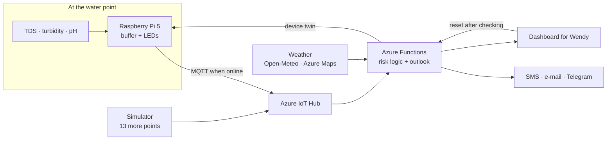

# Wendy's Early Signal

**A low-cost water-quality station and early-warning system for water points in Turkana, Kenya.**
Built in two days at the BCG Platinion hackathon "Fighting World Hunger" (October 2026).

[](../../actions/workflows/ci.yml)
[](LICENSE)
[](LICENSE-docs)

> Hackathon prototype. This is not a certified water-testing device. All limits are placeholders until they are agreed with water experts.

## The problem

In Turkana, many people depend on boreholes, shallow wells and open pans. A water point can turn salty or contaminated without anyone noticing until people are already drinking from it. Field staff can only visit each point now and then, and mobile coverage is patchy.

Wendy is the field officer in our scenario who looks after many water points. She needs to know **which point is getting worse, what people should do now, and where the nearest usable alternative is.**

## What it does

1. **Measures at the water point.** A Raspberry Pi 5 reads salt (TDS / conductivity), turbidity and pH every 30 seconds.
2. **Warns on site, even offline.** Three LEDs show the state: white = station running, yellow = suspicious, red = not drinkable. Measurements are buffered until the network is back.
3. **Combines data in the cloud.** Azure Functions add weather (Open-Meteo, Azure Maps), lab test results and the other water points, estimate the germ risk and forecast the next days.
4. **Alerts people.** SMS, e-mail and Telegram name the problem, what to do (e.g. "do not boil salty water") and the nearest alternative water point.
5. **Keeps a human in the loop.** A warning stays on until someone has checked the water point and resets it in Wendy's dashboard.



### The traffic light

| LED | Meaning | Triggered by |
|---|---|---|
| white | Station running, no anomaly measured. **Not** "safe". | `uploader.py` running |
| yellow | Suspicious: probably not drinkable as it is | TDS > 700 ppm, pH outside 6.5–8.5, turbidity > 500 NTU, or a germ risk from the cloud |
| red | Not drinkable, whatever you do (boiling makes salty water worse) | TDS > 800 ppm, or salt red from the cloud |

The limits live in [`shared/limits.json`](shared/limits.json); the Pi, the cloud and the animations all read that file. Yellow and red only go up on their own. They go off when a person who checked the water point presses **Reset water** in the dashboard.

## Repository

| Folder | What |
|---|---|
| [`pi/`](pi/) | Runs on the Raspberry Pi: sensor conversions, uploader with offline buffer, LEDs, sensor test scripts |
| [`cloud/`](cloud/) | Azure Functions: ingest, risk logic, outlook, alerts, live dashboard |
| [`shared/`](shared/) | What the Pi and the cloud agree on: the limits ([`limits.json`](shared/limits.json)) and the message formats ([`protocol/`](shared/protocol/)) |
| [`simulator/`](simulator/) | Simulates 13 more water points for the demo |
| [`geo/`](geo/) | Turkana map: water points and cell towers, built into GeoJSON for the website and the cloud |
| [`frontend/`](frontend/) | The project website (GitHub Pages) |
| [`animations/`](animations/) | Remotion videos: wiring guides and how the station works |
| [`docs/hardware.md`](docs/hardware.md) | Parts, wiring, formulas, calibration, lessons learned |

Each Python part has its tests next to it: `pi/tests/`, `cloud/tests/`, `shared/tests/`.

## Try it without hardware

```bash
pip install -r requirements-dev.txt
pytest                                                    # sensor maths, LEDs, risk logic, outlook, protocol
python3 -c "import sys; sys.path.insert(0, 'cloud'); import logic; print(logic.demo())"
python3 pi/uploader.py --fake --dry-run --count 3 --no-leds
```

`logic.demo()` prints the alert for a salt event at the live station. The uploader with `--fake --dry-run` prints the JSON it would send.

## Build and run it

- **Station:** parts and wiring in [`docs/hardware.md`](docs/hardware.md), setup on the Pi in [`pi/README.md`](pi/README.md).
- **Cloud:** Azure setup, deployment, alerts and the demo flow in [`cloud/README.md`](cloud/README.md).
- **Animations:** `cd animations && npm ci && npm run studio`
- **Turkana map:** `python3 geo/build_map.py`, then open `geo/dist/turkana-map.html`.

## What is real and what is a placeholder

- **Real:** the station with three sensors, offline buffer, LEDs and upload to Azure; risk logic, outlook, dashboard and SMS alerts; weather data; the human reset.
- **Placeholder:** salt limits (700 / 800 / 5000 mg/L) and the weights of the germ-risk formula; the coordinates of the 14 water points (roughly near Lodwar); 13 of the 14 points are simulated; turbidity in NTU is only a rough estimate.

## Ideas for next steps

- Cheaper hardware: a Raspberry Pi Pico or ESP32 instead of the Pi, with solar power
- SMS uplink over 2G or LoRa where there is no mobile data
- Africa's Talking instead of Twilio for SMS in Kenya
- Predict pump failures from usage and sensor data
- Validate limits and the germ-risk model with water experts and real lab tests

## Team

[Jolanda Bolt](AUTHORS.md), [Merlind C. Pohl](AUTHORS.md), [Maximilian Schwingel](https://github.com/m111xi), [Elias Steffen](https://github.com/EliasSteffen) and [Andrea Stefke](AUTHORS.md). See [AUTHORS.md](AUTHORS.md).

Thanks to BCG Platinion for the hackathon and to Welthungerhilfe for the case.

## Data sources

- Water points: [OpenStreetMap](https://www.openstreetmap.org/copyright) contributors (ODbL) and the [Water Point Data Exchange](https://www.waterpointdata.org/) (CC BY 4.0)
- County boundaries: [geoBoundaries](https://www.geoboundaries.org/)
- Weather: [Open-Meteo](https://open-meteo.com/) and Azure Maps Weather

## License

Code: [MIT](LICENSE). Documentation, images and videos: [CC BY 4.0](LICENSE-docs). Third-party data keeps its own license (see [LICENSE-docs](LICENSE-docs)).
